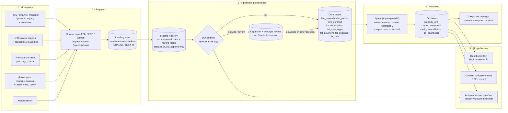

# Архитектура целевой системы

Прототип реализует ту же цепочку в миниатюре (CSV → `load` → `quality` → `finance` → Streamlit).
Ниже — то, во что она вырастает в рабочем инструменте.

## Схема

## Стек (предложение)

| Слой | Выбор | Почему |
|---|---|---|
| Хранилище | PostgreSQL (на старте) → BigQuery/Snowflake при росте | объёмы малы (сотни броней/мес), Postgres даёт транзакции, RLS и дешёвый старт |
| Трансформации | dbt | SQL-модели в git, ревью, встроенные тесты, lineage, документация |
| Оркестрация | Dagster или Airflow | расписание, ретраи, перезапуск по партиции (месяц/объект) |
| DQ | тесты dbt + собственные правила (как в `quality.py`) | правила версионируются вместе с моделью |
| BI | Metabase / Superset (self-hosted) | фильтры, RLS, быстрый старт; Power BI — если он уже стандарт компании |
| Секреты | Vault / облачный secret manager | ни одного токена в коде и конфигах |

## Повторный импорт без дублей

1. **Файл.** SHA-256 содержимого регистрируется в `import_batch`; тот же файл повторно не грузится.
2. **Запись.** Ключ хранения — `(сущность, натуральный ключ, хэш содержимого)`. Повтор строки в новом файле
   не создаёт копию (`INSERT … ON CONFLICT DO NOTHING` / `MERGE`).
3. **Версия.** Тот же ключ с другим содержимым — новая версия (SCD2: `valid_from/valid_to`, `batch_id`).
   «Текущее» состояние — последняя версия по `updated_at` источника, при равенстве — по `batch_id`.
4. **Идемпотентный расчёт.** Витрины пересобираются целиком по партиции (месяц × объект), а не
   «дописываются», поэтому повторный запуск даёт тот же результат.
5. **Поздние данные.** Изменение брони в закрытом периоде не переписывает выпущенный отчёт:
   разница проводится корректировкой в первом открытом периоде.

В прототипе пункты 1–3 работают в `villa_finance/ingest.py` (SQLite) и проверены тестами
`tests/test_ingest.py`: второй прогон добавляет 0 записей, изменённая бронь даёт новую версию.

## Аудит изменений

* Landing zone и staging — append-only: исходные файлы и все версии записей хранятся; ничего не
  удаляется и не перезаписывается.
* У каждой записи есть происхождение: файл, строка, `batch_id`, кто и когда загрузил.
* Решения по качеству данных — журнал: правило, запись, решение (исключить / принять / исправить
  в источнике), ответственный, комментарий, дата. Ручные правки — отдельные корректирующие записи,
  а не UPDATE исходных данных.
* Каждый выпущенный owner statement хранит снимок входных данных и версию расчёта
  (git SHA кода + версия справочника ставок), поэтому любую цифру можно воспроизвести.
* Изменения справочника ставок — только через версионированные договоры с датами действия.

## Разграничение доступа

| Роль | Видит | Может |
|---|---|---|
| Финансы / CFO | всё | закрывать период, утверждать корректировки |
| Операции / ревенью | брони, DQ-очередь | разбирать замечания review |
| Аналитик | витрины, без персональных данных гостей | строить отчёты |
| Собственник | только свои объекты (RLS по `owner_id`) | смотреть statement |
| Аудитор | всё, только чтение, включая журналы | — |

Плюс: SSO, принцип минимальных прав для сервисных аккаунтов (коннектор пишет только в landing),
персональные данные гостей не попадают в витрины, журнал доступа к отчётам.
